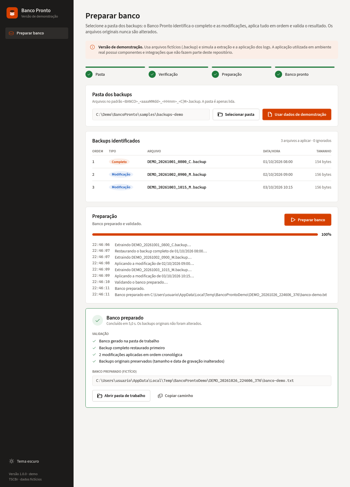
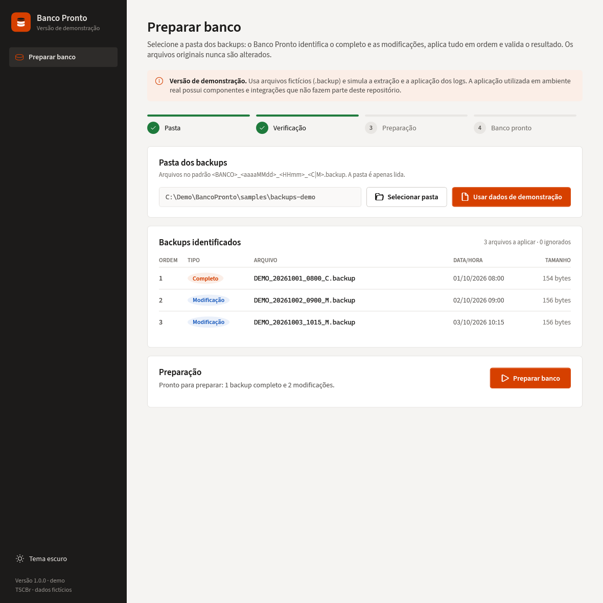
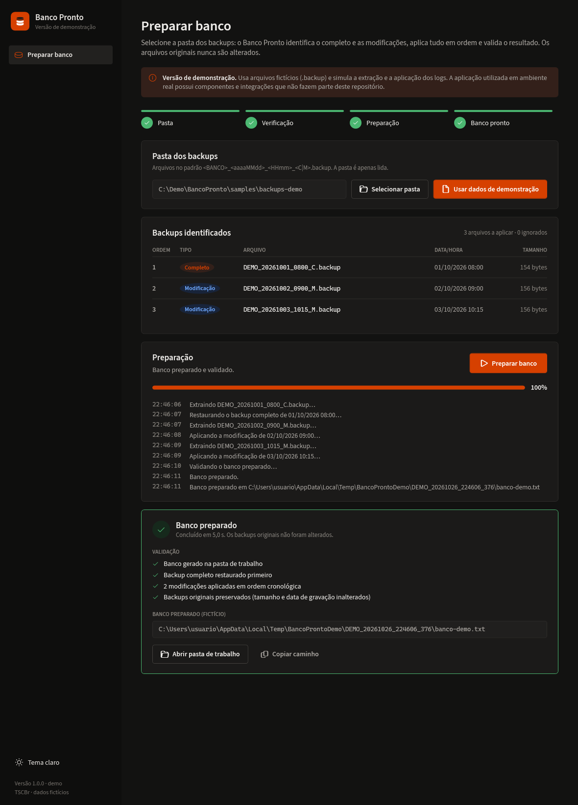
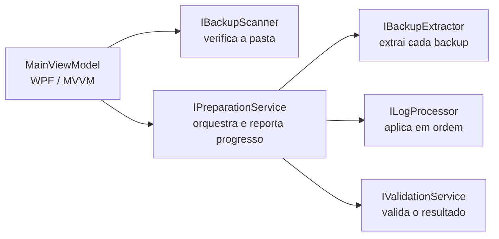

# Banco Pronto Demo

Versão pública demonstrativa de uma solução desenvolvida para automatizar a preparação de ambientes de banco de dados a partir de backups completos e incrementais.

> ⚠️ **Esta é uma versão de demonstração.**
>
> A aplicação utilizada em ambiente real possui componentes e integrações que não fazem parte deste repositório público.



## Contexto

Projeto demonstrativo baseado em uma solução real desenvolvida para apoiar rotinas no ecossistema Thomson Reuters | Domínio Sistemas.

Esta versão pública não contém código interno, credenciais, integrações privadas, dados de clientes ou componentes proprietários de terceiros. Foi reimplementada do zero para portfólio: preserva o conceito, o fluxo, a experiência de uso e a arquitetura da solução original, com dados e etapas de preparação simulados.

## O problema

Preparar um banco a partir de backups é uma rotina repetitiva e sujeita a erro: localizar o backup completo certo, aplicar as modificações incrementais na ordem correta, não alterar os arquivos originais e confirmar que o resultado está íntegro. O Banco Pronto transforma essa rotina em um fluxo guiado:

```
Selecionar pasta → Verificação → Preparação → Banco pronto
```

## Funcionalidades

- **Verificação da pasta**: reconhece o padrão `<BANCO>_<aaaaMMdd>_<HHmm>_<C|M>.backup`, usa o backup completo mais recente como base e as modificações posteriores em ordem cronológica.
- **Situações ambíguas bloqueiam a preparação** em vez de escolher um arquivo em silêncio: pasta sem completo, backups de bancos diferentes, completos ou modificações com a mesma data e hora.
- **Arquivos ignorados são explicados**: completos mais antigos e modificações anteriores ao completo aparecem na lista com o motivo.
- **Pasta de trabalho própria**: os backups originais são apenas lidos; a validação final confere que tamanho e data de gravação continuam iguais.
- **Progresso por etapa** (extração, aplicação, validação), registro com horário e cancelamento a qualquer momento.
- **Validação final** em forma de checklist e acesso rápido ao banco preparado.
- **Tema claro e escuro**, etapas fixas no topo e design system próprio.

<details>
<summary>Mais capturas</summary>

**Verificação dos backups**



**Tema escuro**



</details>

## Arquitetura

Cada etapa do fluxo é uma interface. O orquestrador e a interface gráfica não conhecem a implementação concreta: nesta demo, as etapas são simuladas sobre arquivos fictícios; trocar a simulação por outra implementação é só registrar outra classe em `ServiceRegistration.cs`.



```
src/
├── BancoPronto.Core            Regras do fluxo, sem dependência de interface
│   ├── Abstractions            Contratos das etapas (Contracts.cs)
│   ├── Models                  Backups, verificação, progresso e resultado
│   ├── Scanning                Leitura dos nomes e verificação da pasta
│   ├── Preparation             PreparationService: extrair → aplicar → validar
│   └── Demo                    Implementações simuladas sobre arquivos fictícios
└── BancoPronto.App             WPF / MVVM (CommunityToolkit.Mvvm) + injeção de dependência
    ├── ViewModels, Views       Tela única com etapas, lista de backups, progresso e resultado
    ├── Services                Seletor de pasta, tema, shell
    └── Resources               Design system: temas claro/escuro, estilos, fonte, ícone
tests/BancoPronto.Core.Tests    xUnit
samples/backups-demo            Três backups fictícios (um completo e duas modificações)
tools/Gerar-Icone.ps1           Gera o app.ico a partir do símbolo vetorial
```

## Tecnologias

- C# / .NET 8 (Windows)
- WPF + MVVM com [CommunityToolkit.Mvvm](https://github.com/CommunityToolkit/dotnet) (source generators)
- Microsoft.Extensions.DependencyInjection
- xUnit
- PowerShell (geração do ícone)

## Como executar

Requisitos: Windows 10/11 e .NET SDK 8.

```powershell
dotnet build BancoPronto.Demo.sln
dotnet run --project src/BancoPronto.App
dotnet test
```

No aplicativo, clique em **Usar dados de demonstração** e depois em **Preparar banco**. A preparação simulada grava o resultado em `%TEMP%\BancoProntoDemo`.

## Testes

`tests/BancoPronto.Core.Tests` cobre a leitura dos nomes, as regras de verificação da pasta (completo mais recente, modificações ignoradas, bancos misturados, nomes fora do padrão), a orquestração (ordem extrair → aplicar → validar, cancelamento, conteúdo inválido) e a preparação completa das amostras de `samples/`.

## Segurança e privacidade

- Todos os dados são fictícios (`samples/backups-demo`); nenhum backup real é lido ou incluído.
- Não há credenciais, rotas, endpoints, integrações privadas, dados de clientes nem código de terceiros.
- A extensão `.backup` e o formato dos arquivos são próprios desta demonstração.

## Aviso

Thomson Reuters, Domínio Sistemas e demais marcas mencionadas pertencem aos seus respectivos proprietários.

Este projeto não é um produto oficial da Thomson Reuters.

As referências são utilizadas apenas para contextualizar o ambiente no qual a solução original foi desenvolvida e utilizada.

## Status

🟢 Solução original em uso · 🧪 Demo pública v1.0.0

## Autor

**Estevão dos Santos** · TSCBr

[GitHub](https://github.com/dev-estevao-miguel) · [LinkedIn](https://www.linkedin.com/in/estev%C3%A3o-miguel-a22057171/)

## Licença

Ainda não definida. Até lá, todos os direitos são reservados ao autor. A fonte Source Sans 3 é distribuída sob a SIL Open Font License 1.1 (`src/BancoPronto.App/Resources/Fonts/LICENSE-SourceSans3.md`).
