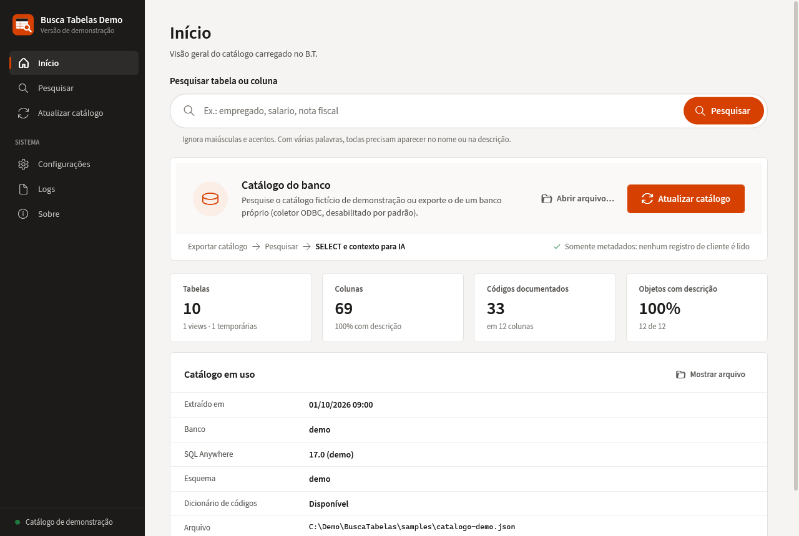
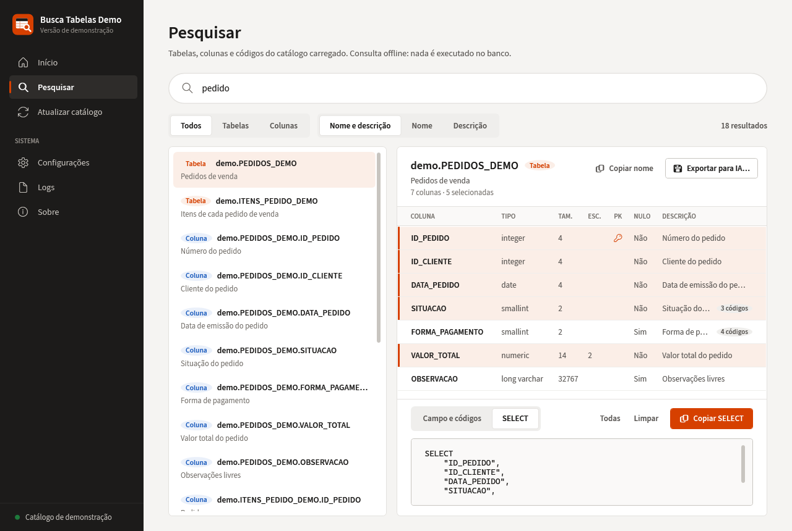
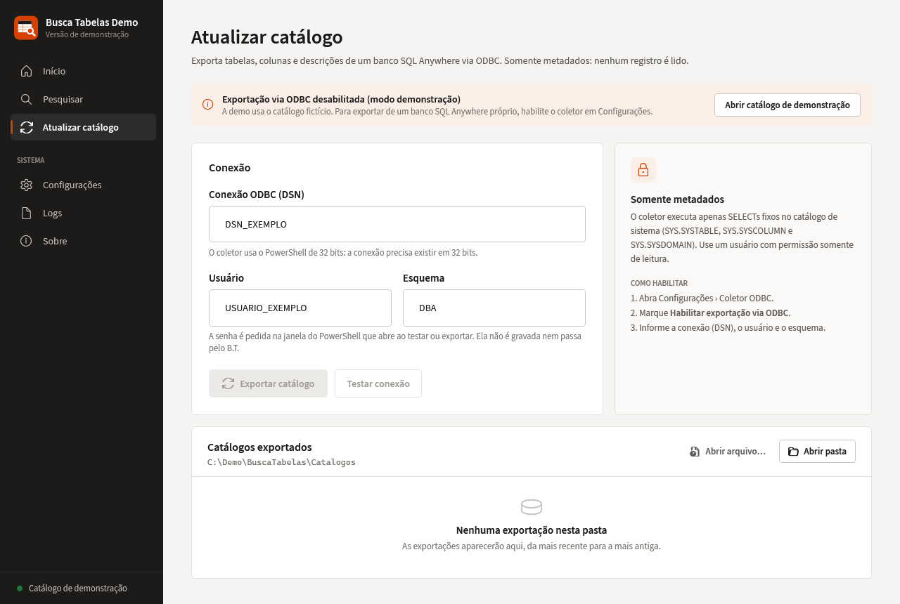

# Busca Tabelas Demo

Ferramenta desktop para pesquisa offline de metadados de bancos SQL.

> ⚠️ **Esta é uma versão de demonstração.**
>
> A aplicação utilizada em ambiente real possui componentes e integrações que não fazem parte deste repositório público.


## Contexto

Projeto demonstrativo baseado em uma ferramenta real desenvolvida para apoiar análise e desenvolvimento de relatórios no ecossistema Thomson Reuters | Domínio Sistemas.

Esta versão pública utiliza somente dados fictícios e não contém credenciais, dados de clientes ou componentes proprietários.

## O problema

Bancos de sistemas corporativos têm milhares de tabelas e dezenas de milhares de colunas. Para escrever um relatório ou revisar uma consulta, é preciso descobrir rapidamente **qual tabela e qual coluna** guardam a informação, com tipo, chave e significado dos códigos. O Busca Tabelas exporta o catálogo de metadados uma vez e permite pesquisá-lo instantaneamente, sem conexão com o banco:

```
Catálogo (JSON) → Pesquisar → Tabela e colunas → SELECT e contexto para IA
```

## Funcionalidades

- **Pesquisa** por nome e/ou descrição, sem diferenciar acentos e maiúsculas; com várias palavras, todas precisam aparecer. Nome exato e nomes que começam com o termo vêm primeiro.
- **Filtros**: todos, só tabelas ou só colunas; nome e descrição, só nome ou só descrição; limite de resultados configurável.
- **Catálogo**: tabelas, views e temporárias com colunas, tipo, tamanho/precisão, escala, chave primária, nulos, valor padrão, descrição e códigos documentados (ex.: `1 = Aberto`).
- **Geração de SELECT**: selecione colunas (Ctrl/Shift + clique) e copie o SELECT com esquema e identificadores entre aspas. O aplicativo não executa consultas.
- **Exportação de contexto em Markdown** de uma tabela, para acompanhar um pedido de revisão de SQL a um assistente de IA. A integração com IA é **apenas exportação de texto**: nada é enviado automaticamente.
- **Execução offline**: o catálogo fictício `samples/catalogo-demo.json` é aberto na primeira execução; nenhum banco é necessário.
- **Validação do catálogo** ao abrir: tabelas e colunas duplicadas, colunas órfãs e códigos sem coluna são recusados.
- **Tema** claro, escuro ou do sistema.

<details>
<summary>Mais capturas</summary>

**Início com o catálogo de demonstração**



**SELECT gerado a partir das colunas selecionadas**



**Coletor ODBC desabilitado por padrão**



</details>

## Conexão com banco (opcional, desabilitada por padrão)

O repositório inclui o coletor que exporta o catálogo de um banco SQL Anywhere via ODBC (`tools/coletor/BT.ps1`). Na demonstração ele vem **desabilitado**: o aplicativo não lê as conexões do Windows nem conecta a nenhum banco até que a opção seja marcada em **Configurações › Coletor ODBC**.

Quando habilitado, o coletor executa apenas SELECTs fixos no catálogo de sistema (`SYS.SYSTABLE`, `SYS.SYSCOLUMN`, `SYS.SYSDOMAIN`), pede a senha somente no terminal do PowerShell e nunca a grava. Os valores padrão são apenas exemplos: `DSN_EXEMPLO`, `USUARIO_EXEMPLO`, esquema `DBA`. Detalhes em [tools/coletor](tools/coletor/README.md) e [docs/como-usar.md](docs/como-usar.md).

## Arquitetura

```
src/
├── BuscaTabelas.Core          Regras, sem dependência de interface
│   ├── Catalog                Modelos, leitura/validação do JSON, índice de pesquisa, SELECT, contexto para IA
│   ├── Collector              Conexões ODBC (registro) e execução do coletor no PowerShell 32 bits
│   ├── Services               Catálogo em uso (CatalogSession)
│   ├── Configuration          AppSettings + persistência JSON
│   └── Logging                Log estruturado em arquivo
└── BuscaTabelas.App           WPF / MVVM (CommunityToolkit.Mvvm) + injeção de dependência
    ├── Views, ViewModels      Uma View por ViewModel, ligadas por DataTemplate
    ├── Services               Navegação, diálogos, tema, shell, abertura de catálogos
    └── Resources              Design system: temas, estilos, fonte, ícone
tests/BuscaTabelas.Core.Tests  xUnit
samples/catalogo-demo.json     Catálogo 100% fictício (12 tabelas, 69 colunas, 33 códigos)
tools/coletor                  Coletor ODBC (embutido no executável)
```

O formato do catálogo é `bt-catalogo-v1`. O índice de pesquisa normaliza nomes e descrições uma única vez ao carregar o catálogo; as buscas rodam fora da thread de interface, com debounce e cancelamento.

## Tecnologias

- C# / .NET 8 (Windows)
- WPF + MVVM com [CommunityToolkit.Mvvm](https://github.com/CommunityToolkit/dotnet) (source generators)
- Microsoft.Extensions.DependencyInjection
- System.Text.Json
- PowerShell 5.1 + System.Data.Odbc (coletor opcional)
- SQL (catálogo de sistema do SQL Anywhere)
- xUnit

## Como executar

Requisitos: Windows 10/11 e .NET SDK 8.

```powershell
dotnet build BuscaTabelas.sln
dotnet run --project src/BuscaTabelas.App
dotnet test
```

O aplicativo abre direto no catálogo de demonstração. Experimente pesquisar `pedido`, `cliente`, `nota fiscal` ou `salario`.

## Testes

`tests/BuscaTabelas.Core.Tests` cobre leitura e validação do catálogo, pesquisa (acentos, filtros, ranking, limite), geração de SELECT, contexto em Markdown, montagem segura do comando do coletor e o catálogo de demonstração.

## Segurança e privacidade

- Somente dados fictícios: o catálogo de exemplo descreve uma empresa imaginária (esquema `demo`).
- Nenhuma credencial, DSN, servidor, caminho de rede, dado de cliente ou material de terceiros.
- O coletor ODBC vem desabilitado e, quando usado, lê apenas metadados, nunca registros.

## Aviso

Thomson Reuters, Domínio Sistemas e demais marcas mencionadas pertencem aos seus respectivos proprietários.

Este projeto não é um produto oficial da Thomson Reuters.

As referências são utilizadas apenas para contextualizar o ambiente no qual a solução original foi desenvolvida e utilizada.

## Status

🟢 Ferramenta original em uso · 🧪 Demo pública v1.0.0

## Autor

**Estevão dos Santos** · TSCBr

[GitHub](https://github.com/dev-estevao-miguel) · [LinkedIn](https://www.linkedin.com/in/estev%C3%A3o-miguel-a22057171/)

## Licença

Ainda não definida. Até lá, todos os direitos são reservados ao autor. A fonte Source Sans 3 é distribuída sob a SIL Open Font License 1.1 (`src/BuscaTabelas.App/Resources/Fonts/LICENSE-SourceSans3.md`).
