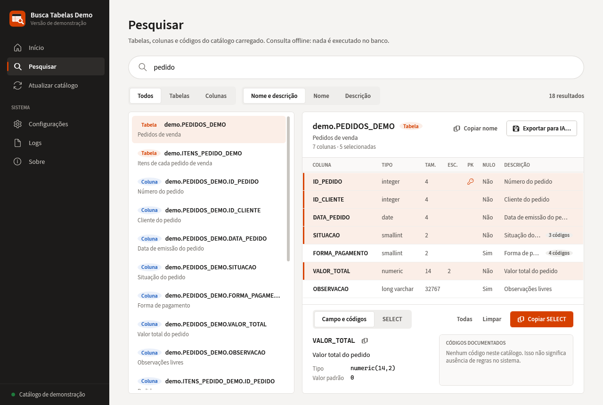

# Ferramentas para Thomson (Domínio Sistemas)

Versões públicas de demonstração de duas ferramentas desktop desenvolvidas para uso no ecossistema Thomson Reuters | Domínio Sistemas.

> ⚠️ **Estas são versões de demonstração.**
>
> As aplicações utilizadas em ambiente real possuem componentes e integrações que não fazem parte deste repositório público. Aqui há somente dados fictícios: nenhum código interno, credencial, integração privada, dado de cliente ou componente proprietário de terceiros.

| Ferramenta | O que faz | Pasta |
|---|---|---|
| **Banco Pronto** | Automação da preparação e validação de bancos a partir de backups completos e incrementais | [Banco-Pronto-Demo](Banco-Pronto-Demo) |
| **Busca Tabelas** | Pesquisa offline de metadados, geração de SELECTs e apoio ao desenvolvimento de relatórios SQL | [Busca-Tabelas-Demo](Busca-Tabelas-Demo) |

## Banco Pronto

Identifica o backup completo e as modificações de uma pasta, aplica tudo em ordem cronológica numa pasta de trabalho própria e valida o resultado, sem alterar os arquivos originais.


## Busca Tabelas

Pesquisa tabelas, colunas, descrições e códigos de um catálogo de metadados sem conexão com o banco, monta o SELECT das colunas escolhidas e exporta o contexto de uma tabela em Markdown para revisão de SQL com IA.



## Tecnologias

- C# / .NET 8 (Windows)
- WPF + MVVM com CommunityToolkit.Mvvm (source generators)
- Microsoft.Extensions.DependencyInjection
- xUnit
- PowerShell e SQL (coletor opcional do Busca Tabelas)

## Como executar

Requisitos: Windows 10/11 e .NET SDK 8.

```powershell
# Banco Pronto
cd Banco-Pronto-Demo
dotnet run --project src/BancoPronto.App
dotnet test

# Busca Tabelas
cd Busca-Tabelas-Demo
dotnet run --project src/BuscaTabelas.App
dotnet test
```

Cada pasta tem o próprio README com arquitetura, funcionalidades e detalhes de segurança.

## Aviso

Thomson Reuters, Domínio Sistemas e demais marcas mencionadas pertencem aos seus respectivos proprietários.

Este projeto não é um produto oficial da Thomson Reuters.

As referências são utilizadas apenas para contextualizar o ambiente no qual as soluções originais foram desenvolvidas e utilizadas.

## Autor

**Estevão dos Santos** · TSCBr

[GitHub](https://github.com/dev-estevao-miguel) · [LinkedIn](https://www.linkedin.com/in/estev%C3%A3o-miguel-a22057171/)

## Licença

Ainda não definida. Até lá, todos os direitos são reservados ao autor. A fonte Source Sans 3 é distribuída sob a SIL Open Font License 1.1.
